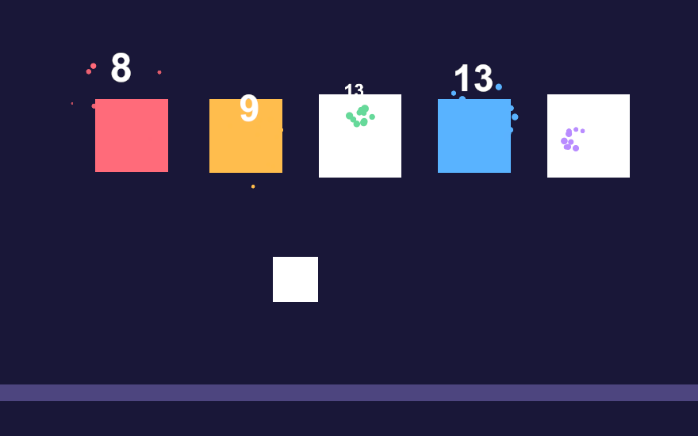

# Unity Juice Skills

給 AI Agent 用的 Unity 遊戲手感技能包。把一句話貼給 Codex、Claude Code 或 Cursor，它就會幫你的遊戲加上鏡頭震動、頓幀、閃白、擠壓拉伸、粒子、音效與 UI 回饋。

不需要付費插件，不需要任何素材，MIT 授權。



## 這是什麼

Juice 是「最小的輸入，換來最大的回饋」：玩法不變，只放大每個動作的感受。這個 Repo 有兩樣東西：

- **12 個 Agent Skill**（`skills/`）：教 AI 什麼時候該加哪一種回饋、數值從多少開始、要避開哪些坑。格式是開放的 [Agent Skills](https://agentskills.io) 標準。
- **Juice Kit**（`skills/juice-kit/unity/Juice`）：24 個 C# 腳本加兩個 Shader。畫面與聲音全部用程式產生，一行就能用：

```csharp
Juice.Hit(enemy.gameObject, hitPoint);   // 頓幀＋鏡頭震動＋閃白＋彈一下＋火花＋音效
```

## 安裝：把這段貼給你的 AI Agent

在 Unity 專案的資料夾裡開啟你的 AI Agent，貼上：

```text
請幫我安裝 Juice Skills：先 git clone https://github.com/yayapipi/unity-juice-skills ，再照裡面 INSTALL.md 的步驟，把 Skills 和 Juice Kit 裝進這個 Unity 專案。
```

裝好之後直接說你要什麼：

```text
幫我的遊戲加 Juice，先做最值得做的三個地方。
```

```text
在玩家的子彈打中敵人的時候加上命中回饋：頓幀、鏡頭震動、敵人閃白、火花和音效。
```

更多可以直接複製的句子在 [PROMPTS.md](PROMPTS.md)。

<details>
<summary>其他安裝方式</summary>

**用 skills CLI**（需要 Node.js 22.20 以上）。在 Unity 專案的資料夾執行，照畫面選擇要裝的 Skill 與 Agent：

```bash
npx skills add yayapipi/unity-juice-skills
```

裝完之後再請 AI「用 juice-kit 安裝 Juice Kit」，或自己把 `juice-kit/unity/Juice` 複製到 `Assets/Juice`。

**手動安裝**

1. 下載這個 Repo（綠色的 Code 按鈕 ▸ Download ZIP）。
2. 把 `skills/` 裡的 12 個資料夾複製到 Unity 專案根目錄的 `.agents/skills/`（Codex、Cursor、Gemini CLI、GitHub Copilot）或 `.claude/skills/`（Claude Code）。
3. 把 `skills/juice-kit/unity/Juice` 整個資料夾（含 `.meta` 檔）複製成專案的 `Assets/Juice`。

**只想要腳本，不用 AI**：只做上面的第 3 步就好。

</details>

## 12 個 Skill

| Skill | 做什麼 | 你可以這樣說 |
|---|---|---|
| `juice-audit` | 入口。盤點遊戲裡的事件、排優先順序、逐一加上回饋 | 幫我的遊戲加 Juice |
| `juice-kit` | 安裝與更新 Juice Kit 腳本 | 安裝 Juice Kit |
| `juice-feedback` | 把一個事件的回饋集中在一個元件，在 Inspector 調 | 我想自己調數值 |
| `juice-squash-stretch` | 擠壓、拉伸、彈一下 | 讓角色落地的時候壓扁再彈回來 |
| `juice-screen-shake` | 鏡頭震動、後座、推近 | 爆炸的時候畫面要震 |
| `juice-hit-stop` | 頓幀、慢動作 | 打中的時候頓一下 |
| `juice-hit-flash` | 受擊閃白 | 敵人被打到要閃白 |
| `juice-particles` | 火花、塵土、爆炸、彩帶、拖尾 | 打到牆壁要噴火花 |
| `juice-sfx` | 音高隨機、連擊音階、內建合成音 | 幫每個動作加音效 |
| `juice-ui` | 按鈕回彈、數字滾動、飄字、打字機、轉場 | 讓按鈕按起來有感覺 |
| `juice-jump-forgiveness` | 土狼時間、跳躍緩衝、可變跳躍高度 | 我明明有按跳卻沒跳 |
| `juice-camera-follow` | 鏡頭阻尼跟隨、前視、死區 | 鏡頭跟得太死了 |

在 Codex 裡可以用 `$juice-audit` 直接指定 Skill，Claude Code 是 `/juice-audit`；不指定也可以，AI 會依你說的話自己挑。

## 一行配方

所有呼叫都會自己建立需要的東西（鏡頭上的元件、粒子系統、播放器），不用在場景裡先放任何物件。

```csharp
Juice.Hit(enemy.gameObject, hitPoint);   // 命中
Juice.Hurt(gameObject);                  // 玩家受傷
Juice.Jump(transform);                   // 起跳：拉長＋塵土＋音效
Juice.Land(transform);                   // 落地：壓扁＋塵土＋音效
Juice.Pickup(transform.position);        // 撿到東西
Juice.Coin(transform.position, combo);   // 金幣，連續撿音高越來越高
Juice.Explode(transform.position);       // 爆炸、死亡
Juice.Damage(hitPoint, 12);              // 傷害數字
Juice.Win(transform.position);           // 過關：彩帶＋慢動作
Juice.Lose();                            // 失敗
```

想單獨控制某一種回饋：

```csharp
JuiceShake.Add(0.4f);                         // 鏡頭震動 0–1
JuiceTime.HitStop(0.06f);                     // 頓幀 0.06 秒
JuiceFlash.Play(gameObject);                  // 閃白
JuiceSquash.Squash(transform, 0.25f);         // 壓扁
JuiceBurst.Spark(hitPoint, hitNormal);        // 火花
JuiceSfx.Blip(JuiceBlip.Jump);                // 內建合成音效
JuiceSfx.Play(clip);                          // 自己的音效，音高自動隨機
JuiceFloatingText.Spawn(point, "+1");         // 飄字
JuiceFade.LoadScene("Level2");                // 淡出淡入換場景
```

UI 元件掛上去就會動：`JuiceButton`（按鈕）、`JuiceCounter`（數字滾動）、`JuicePop`（彈出）、`JuiceTypewriter`（打字機）。

## 參數速查表

| 效果 | 起手值 |
|---|---|
| 頓幀 | 一般命中 0.05–0.08 秒，重擊 0.1–0.15 秒，最多 0.2 秒 |
| 鏡頭震動 | 輕擊 0.2，一般命中 0.3–0.4，受傷與擊殺 0.5–0.6，大爆炸 0.7 以上 |
| 擠壓拉伸 | 幅度 0.2–0.3，0.15–0.2 秒彈回 |
| 閃白 | 0.04–0.08 秒 |
| 音高隨機 | 0.9–1.1 倍 |
| 按鈕 | 滑過 1.05 倍、按下 0.95 倍 |
| 慢動作 | 0.2–0.5 倍，維持 0.3–1 秒 |
| 土狼時間 | 0.1 秒 |
| 跳躍緩衝 | 0.15 秒 |

小事小回饋，大事大回饋。每個動作都大震動，重要的事反而沒感覺。

## 示範場景

裝好 Juice Kit 之後，Unity 選單 `Tools ▸ Juice ▸ Create Demo Scene`，按 Play。

畫面左邊有七個開關：音效、擠壓拉伸、閃白、粒子、鏡頭震動、頓幀、傷害數字。一開始全部關閉，用滑鼠點方塊，再一項一項打開，就能感受同一個遊戲差在哪裡。

## 無障礙

有些玩家看到畫面晃動或閃爍會不舒服。Juice Kit 內建三個會自動存檔的設定，請接到你的設定選單：

```csharp
JuiceSettings.ScreenShake = false;  // 關掉震動
JuiceSettings.Flashes = false;      // 關掉閃白
JuiceSettings.Intensity = 0.5f;     // 整體強度 0–1
```

## 相容性

| 項目 | 狀況 |
|---|---|
| Unity 版本 | 在 Unity 6（6000.5.2f1）實際測過。建議 2022.3 以上，其他版本沒有測過 |
| 渲染管線 | URP 與內建管線都測過（[測試方式](tests/README.md)）。HDRP 沒有測過 |
| 2D／3D | 都可以。正交鏡頭與透視鏡頭會自動用不同的震動與粒子散開方式 |
| 輸入系統 | 不限。Kit 本身不讀取任何輸入 |
| 相依套件 | `JuiceButton` 與 `JuiceFade` 需要 Unity UI（uGUI），其他都不需要 |
| AI Agent | 支援 Agent Skills 的工具，例如 Codex、Claude Code、Cursor、Gemini CLI、GitHub Copilot |

兩件要先知道的事：

- **角色的圖請放在子物件**。圖和會受重力掉落的剛體在同一個物件上時，Kit 不會套用擠壓拉伸（Console 會提示一次），因為縮放會連碰撞框一起動，角色會浮起來或卡進地板。把 Sprite 或模型移到子物件就會自動生效，其他回饋不受影響。
- **有暫停選單時**，在進入暫停之前呼叫 `JuiceTime.Cancel();`，再把 `Time.timeScale` 設成 0。否則玩家剛好在頓幀的瞬間按下暫停，遊戲會在暫停選單開著的狀態下繼續跑。

已知限制：飄字用的是 Unity 內建字型，Web 版要顯示中文請自己指定字型（`JuiceAssets.Font`）；粒子是純色圓點，要有造型的特效請用 Particle System 做 Prefab；UI Toolkit 的介面不在支援範圍。

## 需要更完整的方案

這個專案的目標是「夠用、看得懂、AI 能直接套用」。專案變大之後，可以看看這些更完整的工具：

- [Feel](https://feel.moremountains.com)（付費）：上百種回饋、可以在 Inspector 堆疊，官方也提供給 AI 用的 Skills。
- [Cinemachine](https://unity.com/features/cinemachine)（免費）：Unity 官方的鏡頭系統，內建震動（Impulse）、阻尼、前視與死區。
- [DOTween](https://dotween.demigiant.com)、[PrimeTween](https://github.com/KyryloKuzyk/PrimeTween)（免費）：完整的補間函式庫。

## 致謝

這裡的做法都來自公開分享經驗的開發者，程式則是重新寫的：

- Martin Jonasson 與 Petri Purho，[Juice it or lose it](https://www.youtube.com/watch?v=Fy0aCDmgnxg)
- Jan Willem Nijman，[The art of screenshake](https://www.youtube.com/watch?v=AJdEqssNZ-U)
- Squirrel Eiserloh，[Math for Game Programmers: Juicing Your Cameras With Math](https://www.youtube.com/watch?v=tu-Qe66AvtY)（創傷值震動）
- Steve Swink，《Game Feel》
- Maddy Thorson，[Celeste & Forgiveness](https://maddymakesgames.com/articles/celeste_and_forgiveness/index.html)（土狼時間、跳躍緩衝）
- [easings.net](https://easings.net)（緩動曲線）

## 授權

[MIT](LICENSE)。可以用在任何專案，包含商業遊戲，不需要標示出處。

---

## English

A set of 12 [Agent Skills](https://agentskills.io) plus a tiny dependency-free C# kit that lets AI coding agents (Codex, Claude Code, Cursor and others) add game feel to a Unity project: screen shake, hit stop, hit flash, squash and stretch, particles, sound, UI feedback, jump forgiveness and camera follow. No paid plugins and no art or audio assets are needed; everything is generated in code.

Paste this to your agent from inside a Unity project:

```text
Install Juice Skills: git clone https://github.com/yayapipi/unity-juice-skills and follow its INSTALL.md to add the skills and the Juice Kit to this Unity project.
```

Then ask for what you want, for example "add juice to my game, starting with the three moments that matter most". The skill instructions are written in Traditional Chinese; agents handle them fine in any language. Tested on Unity 6000.5 with URP and the Built-in pipeline. MIT licensed.
